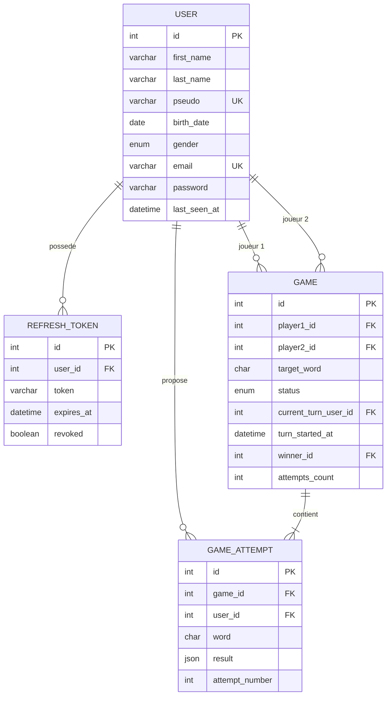
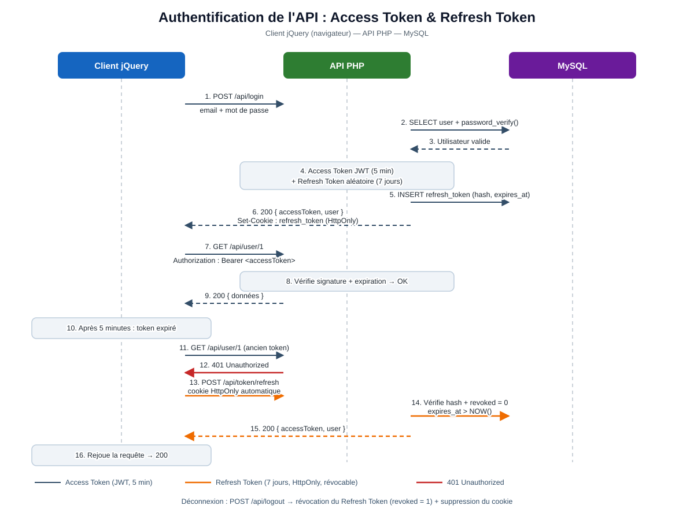
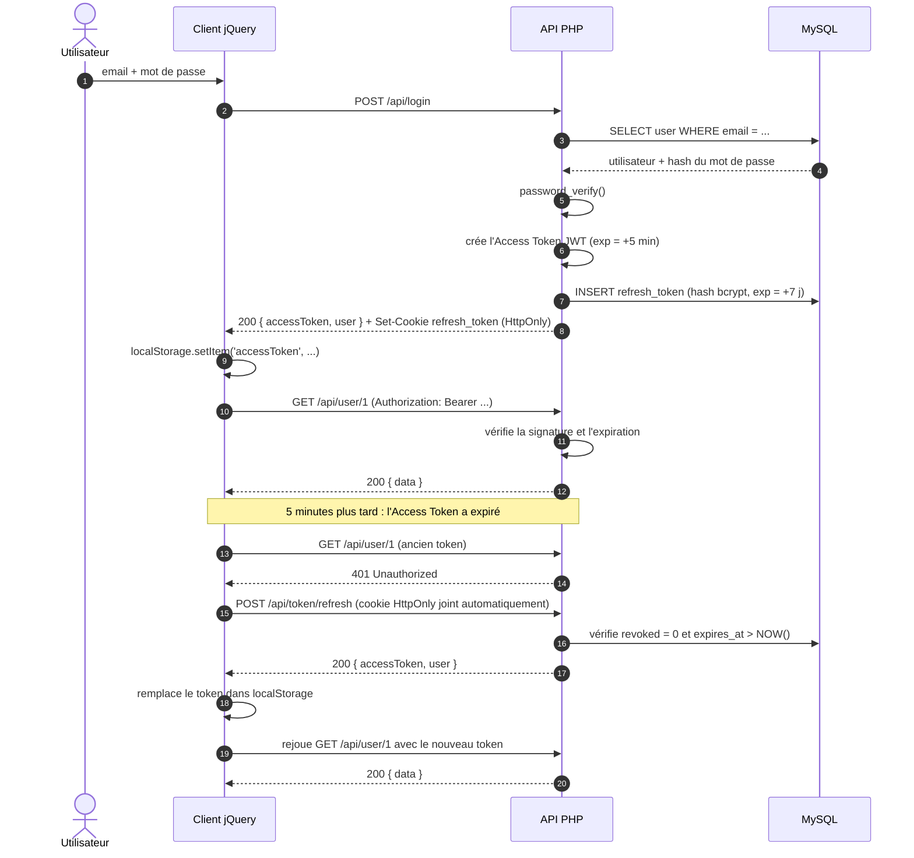
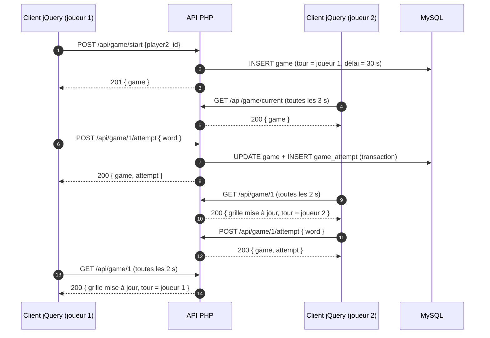

# RESTful-like API en PHP natif

## Avant-propos

Ce projet à vocation pédagogique illustre une mise en œuvre simplifiée en PHP natif d'une API respectant en partie les
contraintes architecturales REST.

## Spécificités

- Implémentation en PHP natif sans dépendances tierces.
- Organisation selon un modèle en couches _Model_/_Controller_, le contrôleur étant en charge de la génération des
  réponses au format JSON.
- Gestion des erreurs personnalisées et journalisation des exceptions.
- Exemples d'opérations standards sur un jeu de données (modèle `User`) :
    - GET
    - POST
    - PUT
    - PATCH
    - DELETE
- Authentification via _JSON Web Token_ (JWT).

## Modèle conceptuel des données

MCD des entités `user`, `refresh_token`, `game` et `game_attempt` avec spécification des types MySQL.
Le schéma relationnel détaillé de la partie collective est présent dans
[`docs/projet-collectif.md`](./docs/projet-collectif.md).



## _Endpoints_ disponibles

### Modèle `User`

- Récupération de tous les utilisateurs :

    ```shell
    GET /api/user
    ```

- Récupération d'un utilisateur en fonction de son identifiant (`user.id`) :

   ```shell
   GET /api/user/{id}
   ```

- Création d'un nouvel utilisateur :

    ```shell
    POST /api/user
    ```

- Modification d'un utilisateur :

    ```shell
    PATCH /api/user/{id}
    ```

- Remplacement d'un utilisateur :

    ```shell
    PUT /api/user/{id}
    ```

- Suppression d'un utilisateur en fonction de son identifiant (`user.id`) :

    ```shell
    DELETE /api/user/{id}
    ```

### Modèle `Game` (partie collective)

- Liste des joueurs connectés et disponibles :

    ```shell
    GET /api/user/available
    ```

- Démarrer une partie contre un joueur (`user.id`) :

    ```shell
    POST /api/game/start
    ```

- Récupérer la partie en cours de l'utilisateur authentifié :

    ```shell
    GET /api/game/current
    ```

- Récupérer l'état d'une partie :

    ```shell
    GET /api/game/{id}
    ```

- Proposer un mot de 6 lettres :

    ```shell
    POST /api/game/{id}/attempt
    ```

- Abandonner une partie :

    ```shell
    POST /api/game/{id}/cancel
    ```

### Authentification JWT

- Connexion :

    ```shell
    POST /api/login
    ```

- Déconnexion :

    ```shell
    POST /api/logout
    ```

- Reconnexion (rafraîchissement du jeton d’accès) :

    ```shell
    POST /api/token/refresh
    ```

## Travail individuel (interface client)

Le fichier `/public/client.php` fournit une interface complète en HTML, CSS et jQuery permettant de :

- créer un compte utilisateur ;
- s'authentifier et se déconnecter ;
- consulter et modifier son profil (pseudo et genre uniquement) ;
- supprimer son compte ;
- rafraîchir automatiquement l'Access Token grâce au Refresh Token lorsque celui-ci expire.

La modification et la suppression sont réservées au propriétaire du compte : le contrôleur frontal transmet
l'identifiant contenu dans le JWT au contrôleur, qui renvoie une erreur **403** en cas de tentative sur un autre compte.

### La méthode AJAX

**AJAX** (*Asynchronous JavaScript and XML*) est une **technique**, pas une bibliothèque : envoyer une requête
HTTP en arrière-plan avec JavaScript, puis mettre à jour une partie de la page avec la réponse, **sans
rechargement complet**.

```text
Utilisateur → navigateur (JavaScript) → requête HTTP → serveur PHP
                    ↑                                        │
                    └──────────── réponse JSON ←─────────────┘
```

Caractéristiques : asynchrone (la page reste utilisable), mise à jour partielle du DOM, échanges JSON légers
et séparation entre le front et l'API.

Le projet encapsule `$.ajax()` dans la fonction `apiRequest()` de `public/client.php`. Elle centralise :

- l'ajout de l'en-tête `Authorization: Bearer <accessToken>` ;
- l'envoi du cookie de rafraîchissement (`withCredentials: true`) ;
- le rafraîchissement automatique du token sur réponse `401`, puis le rejeu **unique** de la requête initiale.

```javascript
$.ajax({
    url: '/api/login',
    method: 'POST',
    data: {email: email, password: password}, // x-www-form-urlencoded
    dataType: 'json'
})
    .done(function (response) { /* 2xx : réponse JSON */ })
    .fail(function (xhr) { /* 4xx, 5xx, erreur réseau */ });
```

Cette même fonction sert à toutes les opérations du client : connexion, profil, salon Motus et propositions
de mots. Le polling du jeu, décrit dans la partie collective, s'appuie dessus.

### Mécanisme d'authentification (Access Token / Refresh Token)

L'API utilise deux jetons complémentaires :

| | **Access Token** | **Refresh Token** |
|---|---|---|
| Nature | JWT signé en HMAC-SHA256 (`HS256`) | Chaîne aléatoire de 64 octets (128 caractères hexadécimaux) |
| Durée de vie | Courte : `JWT_TTL` = 300 s (5 min) | Longue : `JWT_REFRESH_TTL` = 604 800 s (7 jours) |
| Stockage client | `localStorage` | Cookie `HttpOnly`, `SameSite=Lax` |
| Transmission | En-tête `Authorization: Bearer <token>` | Cookie transmis automatiquement par le navigateur |
| Vérification serveur | Signature + expiration (`exp`) | Hash bcrypt en base + `revoked = 0` + `expires_at > NOW()` |
| Révocable | Non (mais durée très courte) | Oui (colonne `revoked`) |
| Rôle | Prouver l'identité à chaque requête | Obtenir un nouvel Access Token sans redemander le mot de passe |

Le Refresh Token n'est jamais stocké en clair : seul son hash bcrypt est conservé en base. Le cookie
`HttpOnly` empêche le JavaScript de le lire, ce qui le protège du vol via XSS.

#### Schéma explicatif





#### Déroulement

1. **Connexion** : `POST /api/login` avec `email` et `password`.
2. **Vérification** : le serveur compare le mot de passe avec `password_verify()` (hash bcrypt).
3. **Access Token** : `JwtService::createToken()` signe un JWT contenant `user_id`, `email`, `iat` et `exp`.
4. **Refresh Token** : `bin2hex(random_bytes(64))`, hashé avec `password_hash()` puis inséré dans la table
   `refresh_token` avec sa date d'expiration.
5. **Réponse** : l'Access Token est renvoyé en JSON ; le Refresh Token part dans un cookie `HttpOnly`
   (inaccessible au JavaScript).
6. **Requêtes protégées** : le client ajoute `Authorization: Bearer <accessToken>` ; le contrôleur frontal
   vérifie la signature et l'expiration avant de transmettre `user_id` au contrôleur.
7. **Expiration** : après 5 minutes, l'API répond `401`.
8. **Rafraîchissement** : `POST /api/token/refresh` vérifie le cookie, le hash bcrypt, `revoked` et
   `expires_at`, puis renvoie un nouvel Access Token.
9. **Reprise** : `apiRequest()` rejoue automatiquement la requête initiale, une seule fois.
10. **Déconnexion** : `POST /api/logout` révoque le Refresh Token (`revoked = 1`), supprime le cookie et le
    client efface l'Access Token du `localStorage`.

**Pourquoi deux jetons ?** L'Access Token court limite les conséquences d'un vol ; le Refresh Token long évite
de redemander le mot de passe toutes les 5 minutes tout en restant révocable côté serveur.

Implémentation : `src/Security/JwtService.php`, `src/Controller/UserController.php`,
`public/front_controller.php` (vérification du Bearer) et `public/client.php`
(`apiRequest()` / `refreshAccessToken()`).

La documentation détaillée (méthode AJAX, schéma du mécanisme d'authentification, détails d'implémentation et
scénarios de test) est disponible dans [`docs/travail-individuel.md`](./docs/travail-individuel.md).

## Projet collectif (Motus)

Le fichier `/public/client.php` contient également le jeu Motus à deux joueurs :

- liste des utilisateurs connectés et disponibles (présence mise à jour toutes les 3 secondes) ;
- création d'une partie en cliquant sur le bouton **Défier** d'un joueur : l'initiateur est le joueur 1 et joue le
  premier ; le joueur invité reçoit un bandeau avec un bouton **Rejoindre la partie** ;
- grille des propositions avec couleurs rouge / jaune / bleu, calculées par le serveur ;
- alternance des tours et synchronisation des deux écrans par **polling AJAX** (3 s dans le salon, 2 s en partie) ;
- limite de 8 propositions au total et de 30 secondes par proposition ;
- victoire, match nul ou abandon, avec révélation du mot cible en fin de partie.

### Communication temps-réel : polling AJAX

Le sujet impose une communication **temps-réel non bidirectionnelle** et exclut explicitement WebSocket.
La solution retenue est le **polling AJAX** : le client interroge périodiquement l'API REST, le serveur ne
fait que répondre. Aucun serveur Node, aucune extension PHP ni bibliothèque supplémentaire n'est nécessaire.

| Situation | Requête | Fréquence |
|---|---|---|
| Salon (aucune partie) | `GET /api/game/current`, puis `GET /api/user/available` | toutes les 3 s |
| Partie active | `GET /api/game/{id}` | toutes les 2 s |
| Partie terminée | aucune requête automatique | — |

Le polling est planifié avec un `setTimeout` **réentrant** (`motusSchedule()`) et non un `setInterval` :
la requête suivante n'est programmée qu'après la réponse précédente. Il n'y a donc jamais deux polls
simultanés, même si le serveur répond lentement.



**Présence des joueurs** : chaque requête authentifiée met à jour `user.last_seen_at`. Un utilisateur est
considéré connecté s'il a été vu il y a moins de 30 secondes. `GET /api/user/available` exclut l'utilisateur
courant, les comptes désactivés et les joueurs déjà engagés dans une partie active. Un onglet fermé disparaît
donc automatiquement du salon après 30 secondes.

### Détails d'implémentation — front-end

Tout se trouve dans `public/client.php` (interface) et `public/assets/css/app.css` (thème), dans la zone
authentifiée, afin de réutiliser le `localStorage`, le cookie de rafraîchissement et `apiRequest()` du
travail individuel.

| Fonction JavaScript | Rôle |
|---|---|
| `startMotusPolling()` / `stopMotusPolling()` | Démarre / arrête la boucle de polling selon la session |
| `motusSchedule()` / `motusPoll()` | Planifie la requête suivante et choisit salon ou partie |
| `loadMotusLobby()` | Récupère la partie en cours, sinon la liste des joueurs disponibles |
| `renderAvailablePlayers()` | Construit les cartes du salon et les boutons « Défier » |
| `startMotusGame()` | `POST /api/game/start` avec l'identifiant du joueur choisi |
| `showMotusGame()` / `renderMotusGame()` | Bascule l'affichage et dessine la grille |
| `motusUpdateCallout()` | Bandeau d'invitation et bouton « Rejoindre la partie » du joueur 2 |
| `motusSetPresence()` / `motusUpdateTimerUI()` | Pastille d'état et compte à rebours (barre de progression) |
| `submitMotusAttempt()` | `POST /api/game/{id}/attempt` avec le mot saisi |
| `leaveMotusGame()` | `POST /api/game/{id}/cancel` après confirmation |
| `motusStartClock()` / `motusStopClock()` | Compte à rebours des 30 secondes |

Points clés :

- `render()` démarre le polling dès que l'utilisateur est authentifié et l'arrête à la déconnexion ;
- en cas de `401`, `apiRequest()` rafraîchit le JWT et rejoue la requête : le polling survit à l'expiration
  de l'Access Token ;
- le DOM est mis à jour avec `.text()` (jamais `.html()`) pour les pseudos : pas d'injection HTML ;
- la saisie est limitée à 6 lettres A-Z, convertie en minuscules et le bouton est désactivé hors tour ;
- le chrono vient du serveur (`seconds_left`) puis est décrémenté localement chaque seconde ;
- le bandeau d'invitation est mémorisé par partie dans `sessionStorage` pour ne pas réapparaître à chaque
  rafraîchissement.

### Détails d'implémentation — back-end

Le sujet demande **au minimum un modèle et un contrôleur supplémentaires** : `Game` et `GameController` ont
été ajoutés, tandis que `User` / `UserController` ont été étendus pour la présence et la disponibilité.

| Fichier / méthode | Rôle |
|---|---|
| `Game::create()` | Crée la partie sous transaction avec `SELECT ... FOR UPDATE` |
| `Game::findActiveForUser()` / `findById()` | Retrouve la partie en cours / une partie avec les deux joueurs |
| `Game::findAttempts()` | Liste les propositions et décode le JSON des couleurs |
| `Game::computeResult()` | Calcule rouge / jaune / bleu en deux passes (lettres en double) |
| `Game::playAttempt()` | Joue un coup de façon atomique (tour, délai, 8 propositions, victoire/nul) |
| `Game::enforceTurnDeadline()` | Passe la main si le délai de 30 secondes est dépassé |
| `Game::cancel()` | Abandonne une partie active |
| `GameController::start/current/show/attempt/cancel()` | Routes du jeu et construction des réponses |
| `User::touchLastSeen()` / `findAvailable()` | Présence (30 s) et liste des joueurs disponibles |
| `UserController::available()` | Endpoint `GET /api/user/available` |

Routes ajoutées :

| Méthode | URL | Description |
|---|---|---|
| `GET` | `/api/user/available` | Joueurs connectés et disponibles |
| `POST` | `/api/game/start` | Démarrer une partie (`player2_id`) |
| `GET` | `/api/game/current` | Partie en cours de l'utilisateur |
| `GET` | `/api/game/{id}` | État d'une partie |
| `POST` | `/api/game/{id}/attempt` | Proposer un mot de 6 lettres (`word`) |
| `POST` | `/api/game/{id}/cancel` | Abandonner la partie |

Sécurité et cohérence côté serveur :

- **identité** : l'identifiant utilisateur vient toujours du JWT vérifié, jamais du corps de la requête ;
- **appartenance** : un non-participant reçoit `403` ;
- **tour** : `current_turn_user_id` est contrôlé (`409` si ce n'est pas le tour du joueur) ;
- **statut** : une partie terminée ne peut plus recevoir de proposition (`409`) ;
- **délai** : au-delà de 30 secondes, la main passe automatiquement à l'adversaire ;
- **concurrence** : création et propositions utilisent une transaction avec `SELECT ... FOR UPDATE` ;
- **anti-triche** : `target_word` est retiré de la réponse JSON tant que la partie est active ;
- **validation** : mot de 6 lettres ASCII (`^[a-z]{6}$`), adversaire existant et différent, joueur non déjà
  en partie.

La base de données est complétée par les tables `game` et `game_attempt` et par la colonne
`user.last_seen_at`. Pour une base déjà initialisée avant ces ajouts, exécuter :

```shell
mysql -u admin -p native_php_restful_api < stuff/migration_collectif.sql
```

Le support de présentation (base de données, démonstration, communication temps-réel, implémentation,
bilan et améliorations) est disponible dans [`docs/projet-collectif.md`](./docs/projet-collectif.md).

## Structure du projet

Arborescence des répertoires et sous-répertoires :
```console
├── public
│   ├── assets
│   │   ├── css
│   │   │   ├── app.css
│   │   │   └── pico.min.css
│   │   └── js
│   │       └── jquery-3.7.1.min.js
│   ├── client.php
│   ├── front_controller.php
│   ├── index.php
│   └── router.php
├── src
│   ├── Core
│   │   ├── Database.php
│   │   └── DotEnv.php
│   ├── Security
│   │   └── JwtService.php
│   ├── Controller
│   │   ├── GameController.php
│   │   └── UserController.php
│   └── Model
│       ├── Game.php
│       └── User.php
├── helpers
│   ├── global_helper.php
│   ├── http_response_helper.php
│   └── jwt_helper.php
├── docs
│   ├── projet-collectif.md
│   ├── travail-individuel.md
│   └── schema-authentification.svg
├── logs
└── stuff

```

Détails :
- `/public`: Point d'accès public (assets, client jQuery), initialisation des variables d'environnement (`.env` : connexion à la base de données, configuration JWT) et chargement des composants nécessaires (`index.php`), routeur du serveur PHP (`router.php`), et contrôleur frontal (`front_controller.php`, en charge du routage via l'analyse du format des requêtes ainsi que de la méthode (GET, POST, PATCH, etc.) utilisée par la requête).
- `/src/Core`: Composants du cœur applicatif.
- `/src/Security`: Composants de sécurité (JWT).
- `/src/Controller`: Implémentation de la logique (analyse des requêtes, application des traitements, élaboration des réponses).
- `/src/Model`: Implémentation des opérations en base de données. 
- `/helpers` : Scripts utilitaires.
- `/logs` : Journalisation applicative (`error.log`), écrite dans le conteneur et consultable avec `docker compose exec app tail -f logs/error.log`.
- `/stuff` : Fichiers et documents annexes.


## Installation

### Avec Docker (recommandé)

Pré-requis : Docker et Docker Compose.

1. Créer le fichier `.env` à partir de l'exemple :

    ```shell
    cp .env.example .env
    ```

    Sous Windows : `copy .env.example .env`.
    Les valeurs par défaut fonctionnent telles quelles (`DB_HOST=db` est le nom du service MySQL
    dans Docker). Penser à changer `JWT_SECRET` et, au besoin, `APP_PORT`.

2. Lancer l'application :

    ```shell
    docker compose up -d --build
    ```

3. Ouvrir <http://localhost:8080/client.php>.

    Si Docker tourne sur un serveur distant (VPS, contexte Docker distant), utiliser l'IP du serveur :
    `http://<IP_DU_SERVEUR>:8080/client.php`. Pour jouer à deux, ouvrir cette même URL sur deux PC,
    deux navigateurs ou une fenêtre privée.

La base `native_php_restful_api`, ses tables (`user`, `refresh_token`, `game`, `game_attempt`) et les
comptes de démonstration sont créés automatiquement au premier démarrage à partir de
`stuff/native_php_restful_api.sql`.

Si la base a été créée avant la suppression du champ `avatar`, exécuter une fois :

```shell
# Bash / macOS / Linux
docker compose exec -T db mysql -uadmin -padmin native_php_restful_api < stuff/migration_suppression_avatar.sql
```

```powershell
# Windows PowerShell
Get-Content -Raw 'stuff/migration_suppression_avatar.sql' | docker compose exec -T db mysql -uadmin -padmin native_php_restful_api
```

Pour une base neuve, aucune migration n'est nécessaire : le script principal ne contient plus la colonne.

Comptes de démonstration :

| Email | Mot de passe |
|---|---|
| `lucas.morel@example.com` | `password` |
| `clara.duval@example.com` | `password` |

Commandes utiles :

```shell
docker compose logs -f app    # logs du serveur
docker compose down           # arrêt (la base est conservée)
docker compose down -v        # arrêt et suppression des données
```

### Sans Docker (optionnel)

Nécessite PHP 8.1+ et MySQL 8.0+.

1. Créer une base `native_php_restful_api` et importer `stuff/native_php_restful_api.sql`.
2. Créer `.env` avec `DB_HOST=localhost` et les identifiants MySQL.
3. Lancer `php -S localhost:8000 -t public public/router.php`, puis ouvrir
   <http://localhost:8000/client.php>.

## Gestion des erreurs

### Codes de réponses HTTP de l'API

Liste des codes utilisés (non exhaustive) :
- **400** - _Bad Request_ : Le corps de la requête est vide ou des données requises sont manquantes.
- **401** - _Unauthorized_ : L'utilisateur n'est pas authentifié.
- **403** - _Forbidden_ : L'accès à la ressource demandée est interdit.
- **404** - _Not Found_ : La route ou l'instance d'un modèle n'ont pu être trouvés.
- **405** - _Method Not Allowed_ : La méthode utilisée par la requête (GET, POST, PATCH, etc.) n'est pas autorisée.
- **500** - _Internal Server Error_ : Il s'agit d'une erreur interne du serveur non spécifiée.
- Etc.

Les codes d'état et messages associés (succès ou erreur) sont inclus à la réponse au format JSON afin de pouvoir traiter les cas particuliers côté client.

### Error Log

Les erreurs applicatives sont journalisées dans `logs/error.log` **à l'intérieur du conteneur** et
envoyées au journal du serveur : elles sont donc aussi visibles avec `docker compose logs`.

```shell
docker compose logs -f app
docker compose exec app tail -f logs/error.log
```

Pour récupérer le fichier sur la machine locale :

```shell
docker compose cp app:/app/logs/error.log ./logs/error.log
```
