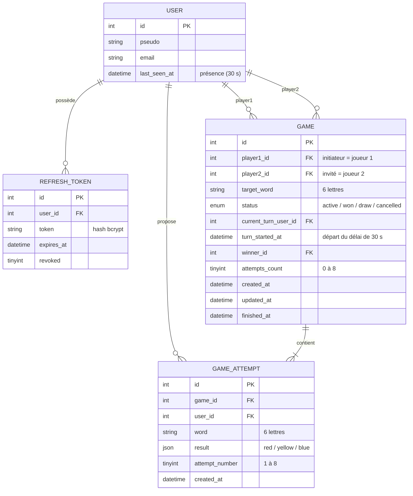
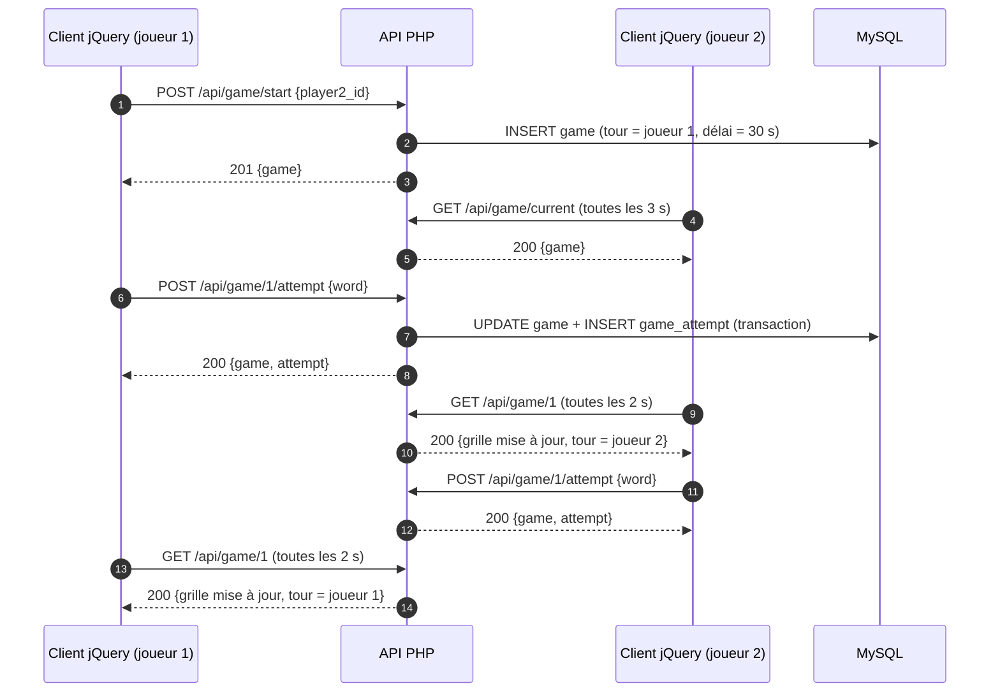

# Projet Motus — Collectif

> Développement Web — Technos legacy — 2025-2026  
> Jeu Motus à deux joueurs, ajouté à l'API PHP native et au client jQuery du travail individuel.

Ce document sert de support à la présentation orale demandée au point **5.2** du sujet. Il suit exactement les
cinq points à expliquer :

1. la présentation de la base de données ;
2. la démonstration de l'application ;
3. la solution retenue pour la communication « temps réel » ;
4. les détails d'implémentation côté front et côté back ;
5. le bilan et les améliorations possibles.

---

## 1. Présentation de la base de données

### 1.1 Modèle conceptuel / relationnel

La base initiale (`user` + `refresh_token`) est conservée et complétée par **deux tables** et **une colonne** :

| Élément | Rôle |
|---|---|
| `user.last_seen_at` | Date de dernière activité. Un utilisateur est « connecté » s'il a été vu il y a moins de 30 secondes. |
| `game` | Une partie : les deux joueurs, le mot cible, le tour en cours, le compteur de propositions et le résultat. |
| `game_attempt` | Une proposition : le mot saisi, son numéro et le tableau des couleurs obtenues. |



Le schéma complet est aussi disponible dans [`stuff/native_php_restful_api.sql`](../stuff/native_php_restful_api.sql).

### 1.2 Choix de modélisation

- **`game.target_word`** est stocké dans la table, tiré au hasard dans une liste de mots de 6 lettres définie
  dans le modèle `Game`. Cela évite une table de dictionnaire supplémentaire, le sujet autorisant les mots
  inventés. Le mot cible **n'est jamais envoyé au client tant que la partie est active** : le contrôleur le
  retire de la réponse JSON pour éviter la triche.
- **`game_attempt.result`** est une colonne `JSON` : on y stocke directement le tableau de couleurs calculé
  par le serveur, par exemple `["blue","red","yellow","blue","red","blue"]`. Le client n'a donc aucun calcul
  à faire et ne peut pas le modifier.
- **`uniq_game_attempt (game_id, attempt_number)`** garantit qu'il n'y a pas deux propositions portant le même
  numéro dans une même partie.
- Les clés étrangères utilisent `ON DELETE CASCADE` : supprimer un utilisateur ou une partie supprime
  proprement les tentatives associées. `winner_id` utilise `ON DELETE SET NULL`.
- **`user.last_seen_at`** est mis à jour automatiquement par le contrôleur frontal à **chaque requête
  authentifiée**. Ainsi, le simple fait que le client interroge l'API toutes les 3 secondes prouve qu'il est
  toujours connecté. La déconnexion remet la colonne à `NULL`.

### 1.3 Migration d'une base déjà installée

Le script [`stuff/migration_collectif.sql`](../stuff/migration_collectif.sql) ajoute la colonne et les deux
tables sans supprimer les utilisateurs existants :

```bash
mysql -u admin -p native_php_restful_api < stuff/migration_collectif.sql
```

Pour une installation neuve avec Docker, aucun geste supplémentaire n'est nécessaire : le script principal
contient déjà les nouvelles structures.

---

## 2. Démonstration de l'application

### 2.1 Lancement

```bash
docker compose up --build
```

Ouvrir ensuite le client dans **deux navigateurs ou deux onglets différents** (ce sont les « clients
distincts » demandés) :

- en local : <http://localhost:8080/client.php> ;
- si l'application tourne sur un serveur distant (VPS, Docker context distant) : `http://<IP_DU_SERVEUR>:8080/client.php`.

Dans le cas d'une démonstration sur **deux PC**, les deux machines doivent ouvrir **la même URL** (celle du
serveur) et non `localhost`, qui désigne toujours la machine du navigateur. L'URL de l'API (`DB_HOST`,
`API_URL`, etc.) reste interne au serveur : elle n'a pas à être modifiée côté client.

Comptes de démonstration :

| Joueur | Email | Mot de passe |
|---|---|---|
| Joueur 1 | `lucas.morel@example.com` | `password` |
| Joueur 2 | `clara.duval@example.com` | `password` |

### 2.2 Scénario de démonstration

1. **Connexion des deux joueurs.** Le profil et le bloc « Partie à deux » apparaissent.
2. **Salon.** Le joueur 1 voit le joueur 2 dans la liste des utilisateurs connectés (et inversement). Un
   utilisateur occupé par une partie n'apparaît plus comme « disponible ».
3. **Création de la partie.** Le joueur 1 clique sur **Défier** à côté du joueur 2. Il devient joueur 1 et joue le
   premier. Le joueur 2 voit apparaître un bandeau « … vous a défié ! » avec un bouton
   **Rejoindre la partie** ; sa grille se met à jour sans recharger la page.
4. **Première proposition.** Le joueur 1 saisit un mot de 6 lettres et valide. Les couleurs apparaissent
   immédiatement chez lui ; chez le joueur 2, la grille se met à jour lors de la prochaine requête AJAX.
5. **Alternance.** Le joueur 2 propose à son tour, puis le joueur 1, etc. L'indicateur « À vous de jouer » et
   le nom du joueur surligné changent automatiquement.
6. **Fin de partie.** Soit un joueur trouve le mot (victoire), soit 8 propositions sont atteintes (match nul).
   Le mot cible est alors révélé sur les deux écrans et le bouton « Retour au salon » apparaît.
7. **Abandon.** « Quitter la partie » annule la partie pour les deux joueurs et rend immédiatement les deux
   joueurs disponibles dans le salon.

### 2.3 Règles effectivement appliquées

| Règle du sujet | Implémentation |
|---|---|
| Mots de 6 caractères | Validation serveur `^[a-z]{6}$` + `maxlength="6"` côté client |
| 8 propositions au maximum | `attempts_count` vérifié dans la transaction ; `status = 'draw'` au 8ᵉ coup |
| Les mots peuvent ne pas exister | Aucun dictionnaire : seule la longueur est contrôlée |
| Délai de 30 secondes par proposition | `turn_started_at` en base + compte à rebours client + passage de main automatique côté serveur |
| Couleurs rouge / jaune / bleu | Calcul serveur, deux passes pour gérer les lettres en double |
| Joueur 1 = initiateur, il commence | `player1_id = utilisateur authentifié`, `current_turn_user_id = player1_id` à la création |
| Clients distincts, pas de WebSocket | Polling AJAX (3 s dans le salon, 2 s pendant la partie) |

---

## 3. Solution adoptée pour la communication temps-réel

### 3.1 Pourquoi du polling AJAX ?

Le sujet demande une **communication temps-réel non bidirectionnelle** et exclut explicitement WebSocket.
Le polling est la solution la plus simple dans ce contexte :

- il ne nécessite **aucune dépendance** (ni serveur Node, ni extension PHP, ni bibliothèque supplémentaire) ;
- il réutilise l'API REST et le JWT déjà en place pour le travail individuel ;
- il fonctionne derrière n'importe quel proxy ou hébergeur PHP classique ;
- la latence annoncée est faible (2 secondes), largement suffisante pour un jeu au tour par tour.

Le client reste maître du rythme : il demande l'état du jeu, le serveur ne fait que répondre. C'est une
communication **unidirectionnelle du point de vue du serveur** : il n'envoie jamais de requête au navigateur.

### 3.2 Fréquences

| Situation | Requête | Fréquence |
|---|---|---|
| Salon (aucune partie) | `GET /api/game/current`, puis `GET /api/user/available` | 3 secondes |
| Partie active | `GET /api/game/{id}` | 2 secondes |
| Partie terminée | Aucune requête automatique | — |

L'implémentation utilise un `setTimeout` **réentrant** (`motusSchedule()`) plutôt qu'un `setInterval` :
la prochaine requête n'est programmée qu'après la réponse précédente. Il n'y a donc jamais deux polls
simultanés, même si le serveur met du temps à répondre.



### 3.3 Détection des joueurs disponibles

La disponibilité est déduite de l'activité, sans table supplémentaire :

- chaque requête authentifiée appelle `User::touchLastSeen()` (`UPDATE user SET last_seen_at = NOW()`) ;
- `User::findAvailable()` sélectionne les utilisateurs dont `last_seen_at >= NOW() - INTERVAL 30 SECOND`,
  sauf soi-même, les comptes désactivés **et ceux qui ont déjà une partie active** ;
- seuls `id`, `pseudo` et `last_seen_at` sont renvoyés (aucune donnée sensible).

Un joueur qui ferme son onglet n'envoie plus de requête : il disparaît automatiquement du salon après
30 secondes. Une déconnexion explicite le fait disparaître immédiatement.

---

## 4. Détails d'implémentation

### 4.1 Côté front — `public/client.php`

Le bloc « Motus » a été ajouté **dans la zone authentifiée** de `client.php`, afin de réutiliser le
`localStorage`, le cookie de rafraîchissement et la fonction `apiRequest()` du travail individuel.

| Fonction JavaScript | Rôle |
|---|---|
| `startMotusPolling()` / `stopMotusPolling()` | Démarre / arrête la boucle de polling selon l'état de la session |
| `motusSchedule()` / `motusPoll()` | Planifie la requête suivante et choisit salon ou partie |
| `loadMotusLobby()` | Récupère la partie en cours, sinon la liste des joueurs disponibles |
| `renderAvailablePlayers()` | Construit les cartes du salon et les boutons « Défier » |
| `startMotusGame()` | `POST /api/game/start` avec l'identifiant du joueur choisi |
| `showMotusGame()` / `renderMotusGame()` | Bascule l'affichage et dessine la grille |
| `motusUpdateCallout()` | Affiche le bandeau d'invitation et le bouton « Rejoindre la partie » du joueur 2 |
| `motusSetPresence()` | Met à jour la pastille Salon / Partie en cours / Partie terminée |
| `motusUpdateTimerUI()` | Met à jour le compte à rebours et sa barre de progression |
| `submitMotusAttempt()` | `POST /api/game/{id}/attempt` avec le mot saisi |
| `leaveMotusGame()` | `POST /api/game/{id}/cancel` après confirmation |
| `motusStartClock()` / `motusStopClock()` | Compte à rebours des 30 secondes |

Points notables :

- `render()` démarre le polling dès que l'utilisateur est authentifié et l'arrête à la déconnexion ;
- la feuille de style dédiée `public/assets/css/app.css` (chargée après Pico CSS) porte le thème sombre, les
  cartes de joueurs, la grille et le bandeau d'invitation ; aucun framework supplémentaire n'est ajouté ;
- les interventions sur le DOM utilisent `.text()` (et non `.html()`) pour les pseudos : pas d'injection HTML ;
- l'entrée est nettoyée à la saisie (lettres A-Z uniquement, 6 caractères maximum) et convertie en minuscules
  avant l'envoi ;
- le bouton de validation est désactivé quand ce n'est pas le tour du joueur ou quand la partie est terminée ;
- le compte à rebours est fourni par le serveur (`seconds_left`) puis décrémenté localement chaque seconde ;
- en cas de `401`, `apiRequest()` rafraîchit le JWT et rejoue la requête : le polling survit à l'expiration du
  token d'accès.

### 4.2 Côté back — modèle et contrôleur supplémentaires

Le sujet demande **au minimum un modèle et un contrôleur supplémentaires** : deux ont été créés.

#### `src/Model/Game.php`

| Méthode | Rôle |
|---|---|
| `create()` | Crée la partie sous transaction avec `SELECT ... FOR UPDATE` |
| `findActiveForUser()` | Retrouve la partie en cours d'un utilisateur |
| `findById()` | Récupère la partie avec les pseudos des deux joueurs |
| `findAttempts()` | Liste les tentatives et décode le JSON des couleurs |
| `computeResult()` | Calcule rouge / jaune / bleu en deux passes |
| `playAttempt()` | Joue un coup de façon atomique (tour, délai, 8 coups, victoire/nul) |
| `enforceTurnDeadline()` | Passe la main si le délai de 30 secondes est dépassé |
| `cancel()` | Abandonne une partie active |

Extrait du calcul des couleurs (la seconde passe empêche de colorier plus de fois une lettre qu'elle
n'apparaît dans le mot cible) :

```php
// 1re passe : lettres bien placées
foreach ($wordLetters as $index => $letter) {
    if ($letter === $targetLetters[$index]) {
        $result[$index] = 'red';
        $remaining[$index] = null;
    }
}

// 2e passe : lettres présentes mais mal placées
foreach ($wordLetters as $index => $letter) {
    if ($result[$index] !== 'red') {
        $foundIndex = array_search($letter, $remaining, true);
        if ($foundIndex !== false) {
            $result[$index] = 'yellow';
            $remaining[$foundIndex] = null;
        }
    }
}
```

#### `src/Controller/GameController.php`

| Méthode | Rôle |
|---|---|
| `start($userId)` | Vérifie l'adversaire et démarre la partie |
| `current($userId)` | Renvoie la partie en cours ou `null` |
| `show($gameId, $userId)` | Renvoie une partie dont le joueur est participant |
| `attempt($gameId, $userId)` | Enregistre une proposition et renvoie la grille mise à jour |
| `cancel($gameId, $userId)` | Abandonne la partie |

La méthode privée `present()` construit la réponse JSON et **supprime `target_word` tant que la partie est
active**. Elle ajoute aussi `seconds_left`, les pseudos des joueurs et les couleurs des tentatives.

### 4.3 Routes ajoutées

| Méthode | URL | Description |
|---|---|---|
| `GET` | `/api/user/available` | Joueurs connectés et disponibles |
| `POST` | `/api/game/start` | Démarrer une partie (`player2_id`) |
| `GET` | `/api/game/current` | Partie en cours de l'utilisateur |
| `GET` | `/api/game/{id}` | État d'une partie |
| `POST` | `/api/game/{id}/attempt` | Proposer un mot (`word`) |
| `POST` | `/api/game/{id}/cancel` | Abandonner la partie |

Toutes ces routes passent par l'authentification JWT du contrôleur frontal.

### 4.4 Sécurité et cohérence

- **Identité** : l'identifiant utilisateur provient toujours du JWT vérifié, jamais du corps de la requête.
- **Appartenance** : toute lecture ou action sur une partie vérifie que l'utilisateur est l'un des deux joueurs
  (sinon `403`).
- **Tour** : `current_turn_user_id` est contrôlé côté serveur (sinon `409`). Un joueur ne peut pas jouer deux fois
  de suite.
- **Statut** : une partie terminée ne peut plus recevoir de proposition (`409`).
- **Délai** : au-delà de 30 secondes, la main passe automatiquement à l'adversaire.
- **Concurrency** : la création et les tentatives utilisent une transaction avec `SELECT ... FOR UPDATE`,
  ce qui empêche deux requêtes simultanées de placer le même joueur dans deux parties ou d'enregistrer deux
  coups au même numéro.
- **Validation** : mot de 6 lettres ASCII, adversaire existant et différent de soi, joueur non déjà en partie.

---

## 5. Bilan et améliorations possibles

### 5.1 Bilan

L'objectif est atteint avec une architecture volontairement simple :

- la base initiale est complétée sans casser l'existant (script de migration fourni) ;
- un modèle et un contrôleur supplémentaires suffisent à toute la logique du jeu ;
- aucun WebSocket ni service tiers : le polling AJAX respecte la contrainte du sujet ;
- l'interface précédente (inscription, connexion, profil, refresh automatique) reste inchangée dans son
  fonctionnement ;
- les règles importantes (6 lettres, 8 coups, alternance, délai de 30 s, couleurs, victoire/nul) sont
  **vérifiées côté serveur**, pas seulement dans le navigateur.

### 5.2 Limites

- Le polling génère des requêtes même quand rien ne change (2 à 3 s) : ce n'est pas aussi efficace qu'un
  WebSocket pour un grand nombre de joueurs.
- La liste des joueurs repose sur un seuil de 30 secondes : un onglet laissé ouvert mais inactif apparaît
  encore comme connecté.
- Le mot cible est tiré dans une liste courte de mots codée en PHP : un joueur qui connaît la liste peut
  tenter les mots un par un (les 8 tentatives restent toutefois limitées).
- Le délai de 30 secondes est strict : sur une connexion lente, une proposition peut être refusée alors que
  le joueur était en train de la saisir.
- Aucune parties historisées ne sont affichées dans l'interface : seul l'état en cours est conservé.

### 5.3 Perspectives

| Amélioration | Bénéfice |
|---|---|
| Remplacer le polling par des Server-Sent Events (SSE) | Communication serveur → client en temps réel, moins de requêtes |
| Passer les mots cibles dans une table `word` avec plusieurs niveaux de difficulté | Variabilité et extensible sans redéployer le code |
| Ajouter un chronomètre serveur avec horodatage précis (millisecondes) | Délai de 30 secondes plus juste |
| Afficher l'historique des parties et un classement (victoires / nuls) | Donne un intérêt supplémentaire au jeu |
| Gérer la reconnexion après actualisation de la page (reprise de la partie en cours) | Déjà partiellement couvert par `GET /api/game/current`, à rendre visible dans l'UI |
| Ajouter des tests automatisés (PHPUnit) sur `computeResult()` et sur les transitions de statut | Protection contre les régressions |

---

## 6. Récapitulatif des fichiers modifiés / ajoutés

| Fichier | Modification |
|---|---|
| `stuff/native_php_restful_api.sql` | **Modifié** : `last_seen_at`, tables `game` et `game_attempt` |
| `stuff/migration_collectif.sql` | **Ajouté** : migration pour une base déjà installée |
| `src/Model/User.php` | **Modifié** : `touchLastSeen()`, `markOffline()`, `findAvailable()` |
| `src/Controller/UserController.php` | **Modifié** : endpoint `/api/user/available`, mise à jour de la présence |
| `src/Model/Game.php` | **Ajouté** : logique de partie, couleurs, transaction, délai de 30 s |
| `src/Controller/GameController.php` | **Ajouté** : routes et contrôles de la partie |
| `public/front_controller.php` | **Modifié** : nouvelles routes et rafraîchissement de la présence |
| `public/client.php` | **Modifié** : salon Motus, bouton « Défier », bandeau d'invitation, grille, polling, compte à rebours |
| `public/assets/css/app.css` | **Ajouté** : thème de l'interface (cartes, grille, responsive) |
| `docs/projet-collectif.md` | **Ajouté** : ce document |
| `README.md` | **Modifié** : endpoints et documentation collective |
